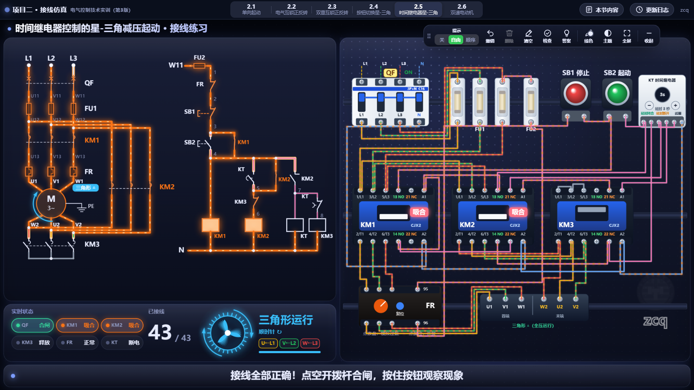
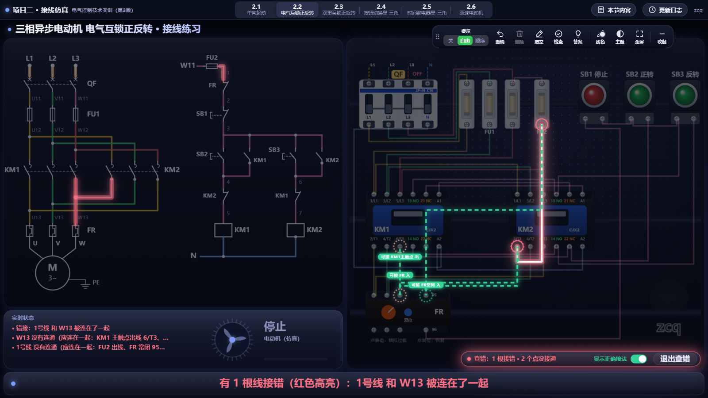
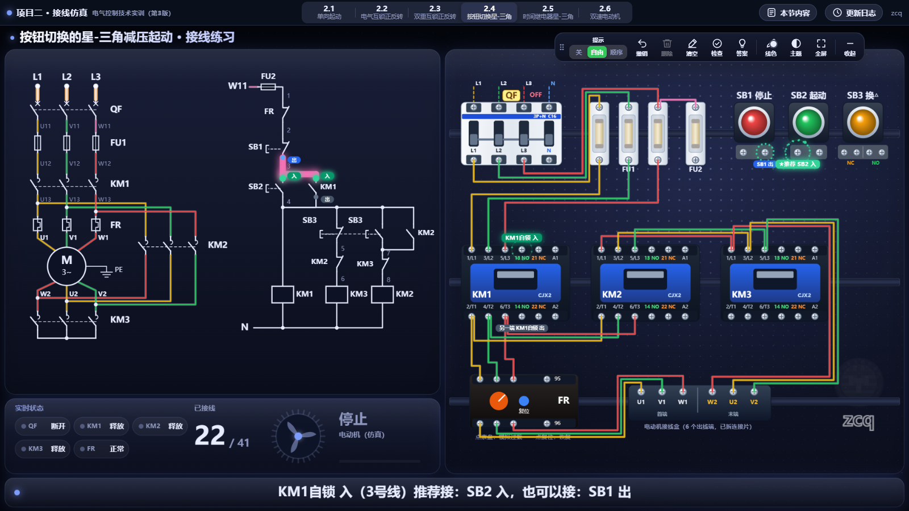
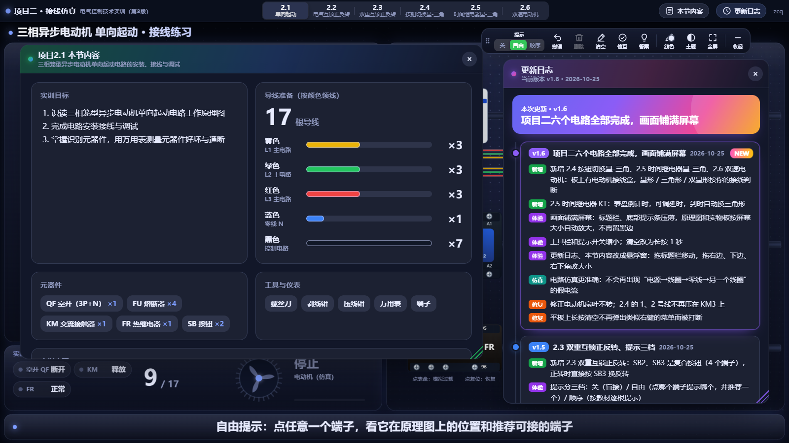

# 项目二接线仿真

《电气控制技术实训（第3版）》项目二的在线接线练习。在浏览器里照着原理图在实物板上连线，检查对错，再合闸、按按钮仿真试车。打开就能用，不用安装，电脑、平板、希沃触屏都可以。

**在线打开：<https://zcq19991029.github.io/wiring-lab/>**

## 六个电路

| 电路 | 内容 | 直接打开 |
|---|---|---|
| 2.1 | 三相异步电动机单向起动 | [#2.1](https://zcq19991029.github.io/wiring-lab/#2.1) |
| 2.2 | 电气互锁正反转 | [#2.2](https://zcq19991029.github.io/wiring-lab/#2.2) |
| 2.3 | 双重互锁正反转 | [#2.3](https://zcq19991029.github.io/wiring-lab/#2.3) |
| 2.4 | 按钮切换的星-三角减压起动 | [#2.4](https://zcq19991029.github.io/wiring-lab/#2.4) |
| 2.5 | 时间继电器控制的星-三角减压起动 | [#2.5](https://zcq19991029.github.io/wiring-lab/#2.5) |
| 2.6 | 双速电动机 | [#2.6](https://zcq19991029.github.io/wiring-lab/#2.6) |

顶部的分段按钮可以随时切换电路，每个电路的接线分开保存，切走再回来不会丢。

## 能做什么

- **连线**：从一个端子拖到另一个端子，或者先点一个端子、再点另一个。走线自动横平竖直、互相错开；选中导线后可以拖线段和拐点调整走线。
- **原理图同步**：选中端子时，原理图上对应的点会发光；接线全对后，通电的支路会随试车同步发光。
- **提示三档**：关（盲接自测）/ 自由（点哪个端子提示哪个，并推荐一个可接的）/ 顺序（按教材顺序一根一根提示）。
- **检查与查错**：检查不通过时，只把接错的线红色高亮，从错线两端引出绿色虚线指向应该接的端子，底部写出改法。
- **仿真试车**：合空开、按按钮，接触器吸合、电动机转动；星形 / 三角形 / 双星形按你实际的接线判断，接错会短路跳闸或反转。
- **本节内容**：实训目标、按颜色统计的导线根数、元器件、工具和实训步骤，方便课前领线备料。
- **更新日志**：每次更新后第一次打开会自动弹出，列出这次改了什么。
- 线色、线宽、四套主题可调，支持全屏。

## 平板与触屏

横屏使用效果最好。触摸时端子、按钮、导线的点击范围会放大；双击不会缩放页面，长按也不会弹出菜单；清空需要长按 1 秒，防止误触。

## 版权

© 2026 zcq 保留所有权利。本网页仅供通过上面的正版网址在线使用（课堂教学、个人学习）。未经书面许可，禁止复制、下载后重新发布、修改、反混淆或部署到其他网址，详见 [LICENSE](LICENSE)。网页只在正版网址和本机离线文件中运行。

## 说明

- 这个仓库只放打包好的网页（`index.html`，代码已混淆），用于 GitHub Pages 在线访问。源码在另一个私有仓库里维护。
- 电路接法、端子编号和试车步骤按教材项目二各节的原理图、接线图和通电测试表制作。
